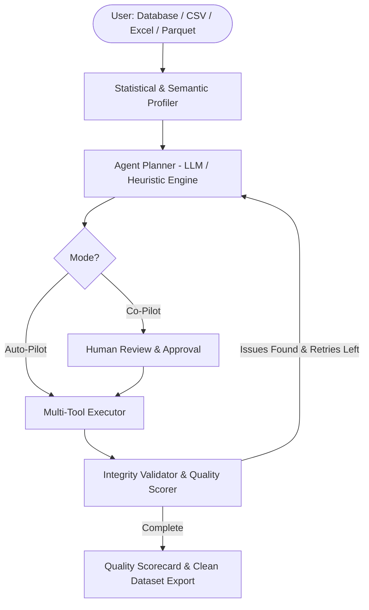

# ⚡ Autonomous Agentic Data Cleaning & Preprocessing Suite

An enterprise-grade, fully autonomous data cleaning and preprocessing system powered by **LangGraph**, **Gemini**, and statistical profiling. The agent accepts any database connection or dataset file, autonomously detects quality defects, formulates an optimal cleaning plan, executes transformations, validates integrity, and produces a complete Quality Scorecard.

---

## 🌟 Key Features

### 1. 🤖 Autonomous Agentic AI (Dual Operating Modes)
- **⚡ Auto-Pilot Mode (1-Click Autonomous)**:
  - Takes raw data, extracts deep statistical profiles, formulates an optimal multi-step cleaning sequence, executes all transformations, and verifies data integrity.
- **🧭 Co-Pilot Mode (Interactive Human-in-the-Loop)**:
  - Formulates the plan, pauses for user inspection and customization in the Streamlit UI, and executes upon human approval.
- **🛡️ 100% Production Resilient**:
  - Incorporates an intelligent fail-safe deterministic engine ensuring zero downtime if offline or experiencing API rate limits.

### 2. 📥 Universal Ingestion & Export Engine
- **Flat Files**: CSV, TSV, Excel (`.xlsx`, `.xls`), and Parquet (`.parquet`).
- **Relational Databases**: SQLite (`.db`, `.sqlite`, URI), PostgreSQL (`postgresql://...`), and MySQL (`mysql+mysqlconnector://...`).
- **Interactive Export**: Instant export to CSV, Excel, or direct write-back to database tables.

### 3. 📊 Deep Statistical Profiler & Health Scorecard
- Evaluates missingness patterns, skewness, cardinality, memory footprint, and outliers.
- Computes an objective **Data Quality Score (0–100)** before and after cleaning.
- Tracks metrics: Nulls eliminated, duplicate rows purged, memory saved (MB / %), and outliers handled.

### 4. 🧰 Comprehensive Preprocessing Operations
- **Data Cleaning**: Smart skewness-aware null imputation (median/mean/mode/drop/interpolate), deduplication, IQR outlier clipping, datatype coercion.
- **Data Transformation**: Label encoding with reverse mapping extraction, Min-Max & Z-Score standardization, Equal Width / Equal Frequency binning.
- **Data Reduction**: Lossless and lossy memory compression, PCA dimensionality reduction, random & stratified sampling.

---

## 🏗️ Architecture



---

## 🚀 Quick Start

### 1. Install Dependencies
```bash
pip install -r requirements.txt
```

### 2. Environment Configuration (Optional for LLM features)
Create a `.env` file in the project root:
```env
GOOGLE_API_KEY="your-gemini-api-key"
```
*(Note: If no API key is provided, the system seamlessly operates via the Autonomous Deterministic Rule-Based Engine).*

### 3. Run the Streamlit Application
```bash
streamlit run src/app.py
```

### 4. Run the Test Suite
```bash
python tests/test_pipeline.py
```

---

## 📁 Repository Structure

```
├── Dataset/                   # Benchmark datasets (Titanic, BostonHousing, Iris, etc.)
├── src/
│   ├── app.py                 # Streamlit UI (Universal Ingestion, Profiling, Manual & Agentic Steps)
│   ├── agent_graph.py         # LangGraph StateGraph agent with memory checkpointing
│   ├── profiler.py            # Statistical profiling & Data Quality Scorecard (0-100)
│   ├── data_connector.py      # Universal database and file ingestion/export engine
│   ├── null_handling.py       # Smart skewness-aware null imputation & individual strategies
│   ├── deduplication.py       # Deduplication engine
│   ├── outlier_detection.py   # IQR winsorization & outlier clipping
│   ├── typecasting.py         # Datatype coercion (datetime, numeric, category)
│   ├── normalization.py       # Min-Max & Standard scalers
│   ├── scaling.py             # Feature scaling utilities
│   ├── discretization.py      # Equal-width, equal-frequency, and k-bins binning
│   ├── label_encoding.py      # Categorical label encoder
│   ├── compression.py         # Lossy & lossless memory reduction
│   ├── dimensionality.py      # PCA & t-SNE dimensionality reduction
│   └── numerosity.py          # Random & stratified sampling, k-means clustering
└── tests/
    └── test_pipeline.py       # Unit and integration test suite
```
